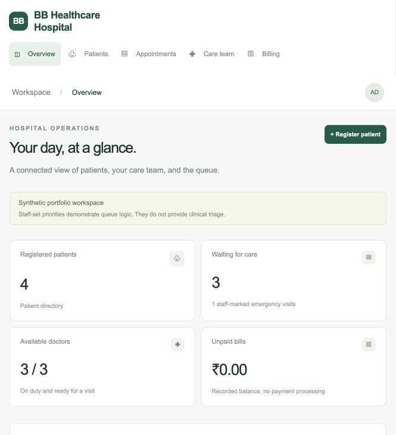
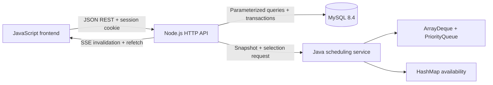

# BB Healthcare Hospital — Smart Hospital Management System

A full-stack hospital-workflow portfolio project built with **Java 21, Node.js, MySQL 8.4, and vanilla JavaScript**. It connects patient registration, doctor availability, queue dispatch, visit records, and billing in one responsive interface.

This is a separate project from the Expense and Budget Analysis repository. All seed patients and records are fictional. Use synthetic data only. The application demonstrates hospital operations; it does not make clinical triage decisions or process payments.



## Features

- Patient registration, searchable directory, and paginated medical history.
- Billing page **Add bill** and patient-level billing shortcuts. Select an unbilled started/completed visit, enter a description and INR amount, then view the saved bill or record its paid status.
- Add and update patient discharge summaries, including diagnosis, treatment, discharge advice, follow-up, and date. Updates append a linked revision, preserving earlier records and rejecting stale updates.
- Upload PNG, JPEG, or WebP medical-report/discharge images up to 2 MB. Private authenticated previews and downloads are linked to the correct patient and optional discharge-summary version. New uploads retain previous images.
- Add medical records directly from Patients: disease/diagnosis, treatment or care plan, recovery status, and clinical notes. Historical entries do not require an appointment. Recovery is recorded by staff, never inferred by the app.
- Doctor registration, duty changes, and live availability updates using Server-Sent Events (SSE).
- In Care team, use **Finish visit & mark available** on a busy doctor's card to complete the active visit and enable calling the next patient. The card identifies the current patient and also links to visit record entry.
- Appointment queues: `Queue`/`ArrayDeque` for normal visits and `PriorityQueue` for staff-assigned emergency visits.
- Deterministic ordering: emergency priority 3 before 2 before 1, then normal visits; equal priority uses arrival time and appointment ID.
- Java `HashMap<Long, Boolean>` availability cache rebuilt from database snapshots.
- Appointment state transitions, consultation notes, integer-paise billing, and payment-status recording.
- Parameterized MySQL queries, indexed patient-history retrieval, doctor-row locks, and unique constraints for active visits.
- Administrator login, signed HttpOnly session cookies, CSRF validation, same-origin writes, input validation, and bounded request bodies.
- Staff directory with editable names and morning/night shift assignments. Harmeet and Milli start on mornings; Vansh starts on both shifts.
- Forgot password flow for configured SMS/email contacts, using Twilio Verify. Delivery credentials must be configured privately before codes can be sent. Successful resets store a salted password hash and invalidate older sessions.

## Quick start: full Java + Node.js + MySQL stack

Install Docker Desktop with Docker Compose. Then:

```bash
git clone https://github.com/kajalsabarwal/Healthcare.git
cd Healthcare
cp .env.example .env
# Edit .env: choose local database/admin passwords and a random session secret.
docker compose up --build -d
```

Open **http://localhost:3000** and sign in with `ADMIN_USERNAME` and `ADMIN_PASSWORD` from `.env`. The Java scheduler and MySQL are internal services; only the app is published, on localhost.

Generate a session secret with `openssl rand -hex 32`. The example values are local placeholders, not production credentials. The database initializes three fictional doctors, four fictional patients, and three queued appointments on its first startup. Existing database volumes are retained on subsequent starts.

```bash
docker compose logs -f app scheduler
docker compose down
```

`docker compose down` preserves data. Schema changes require a migration against existing volumes; the init SQL runs only on a new database. Existing installations with the original demo doctor names can apply `db/002_rename_doctors.sql` using a MySQL client. It updates only the three matching demo records and preserves appointments and other data. Do not remove a data volume unless its contents are disposable.

## Quick preview without Java or MySQL

For an existing MySQL installation, apply `db/003_patient_records.sql` once before using this version. New databases already include the new fields. The migration retains existing diagnoses and notes, adds treatment/recovery fields, and allows standalone records without an appointment. The Docker init script does not migrate existing volumes automatically.

Then apply `db/004_staff_and_recovery.sql` once for staff and persistent reset credentials. Fresh databases include all current tables in `001_schema.sql`.

Existing installations also need `db/005_discharge_and_billing.sql` and `db/006_report_images.sql` once, in that order, for bill descriptions, discharge revisions, and private image storage. Fresh installations already contain these tables. These migrations retain existing data; run each migration only once.

Node.js 22+ is enough for the dependency-free local demo:

```bash
npm run demo
```

Open **http://127.0.0.1:3000**. Login: **admin / demo-hospital**. This mode binds only to localhost, uses an in-memory store and a JavaScript ordering equivalent, and loses changes on restart. It does **not** demonstrate Java execution or database persistence. The Docker stack runs the actual Java/MySQL implementation.

Optional local persistence: set `DEMO_DATA_FILE` to a private JSON path outside the repository. The demo saves data and reset password hashes there after successful changes and restores them on startup. Without it, the demo remains ephemeral. Never publish that file. A reset password overrides the initial demo password when a saved credential exists.

## Password recovery

Click **Forgot password?**, select SMS or email, enter the registered contact and username, then enter the delivered verification code and a new password of at least 12 characters. See [private recovery setup](docs/recovery.md). The registered phone is displayed in the recovery screen when configured; the email display is masked. No user's personal contact is hardcoded in the repository.

If the delivery provider is not configured, the form clearly states that sending codes is unavailable. It never invents or displays a usable verification code. The SMS/email delivery integration is tested with mocks; actual delivery requires the account owner to configure the provider.

## Try a complete workflow

1. Open Appointments and call the next patient for Dr Komal. Isha's staff-marked P2 emergency visit is selected before Aarav's normal visit.
2. Add synthetic visit notes and create a bill for the active appointment.
3. Complete the visit. The doctor becomes available and other connected tabs refresh.
4. Open Patients, search for Isha, and view the saved visit record.
5. Open Billing and mark the bill paid. This records a status only; it makes no financial transaction.
6. Register a patient and add a normal appointment. Toggle an idle doctor off duty and confirm new appointments/dispatch are blocked for that doctor.

## Architecture



Node.js owns validation, authorization, business transitions, transactions, persistence, and SSE. Java selects from a bounded waiting snapshot and computes availability. MySQL is the durable source of truth. Java's maps and queues are rebuildable and contain no patient names or medical notes.

Dispatch holds a `SELECT ... FOR UPDATE` lock on the relevant doctor while taking the queue snapshot, asking Java for the next visit, and changing its status. Enqueue, duty changes, completion, record creation, and billing use the same doctor-lock ordering. MySQL generated unique keys enforce at most one active visit per doctor and one open appointment per patient. Scheduler failure returns 503 and rolls back the transaction; the app does not silently fall back in MySQL mode.

See [architecture and tradeoffs](docs/architecture.md), [API reference](docs/api.md), and [SQL history queries](db/history_queries.sql).

## Project layout

```text
backend/       Node.js API, MySQL adapter, in-memory demo adapter
frontend/      Responsive HTML, CSS, and JavaScript interface
scheduler/     Java HTTP service, collections-based scheduler, Java tests
db/            MySQL schema, seed data, indexed history query examples
tests/         API workflow tests and Docker integration smoke test
docs/          API, architecture, validation notes, screenshot
.github/       Unit and full-stack CI workflow
```

## Tests

```bash
npm test
javac scheduler/Scheduler.java scheduler/SchedulerTest.java
java -cp scheduler SchedulerTest
```

The API suite needs no npm install and uses the demo adapter. Java tests require JDK 21+. GitHub Actions runs both, then starts MySQL, Java, and Node.js with Compose and runs `node tests/integration.mjs`. The integration fixture expects a fresh seeded database. See [validation notes](docs/validation.md) for what was actually run and its limits.

## Scope and scaling

This is a runnable portfolio implementation with bounded queues and dashboard lists (1,000 rows), not a production hospital platform. It provides walk-in queue scheduling rather than future appointment time slots. Emergency priorities are manually assigned for demonstration. Continuous emergencies may starve the normal queue; no automatic clinical urgency inference, aging policy, or consultation preemption is implemented.

The single Node.js instance publishes SSE invalidations to its own clients. Multiple API replicas would need shared pub/sub, distributed rate limits, and consistent event delivery. Java snapshots are rebuilt per request, so queue construction is O(n log n), not an end-to-end O(log n) dispatch. Durable doctor locks serialize operations per doctor and are held during the bounded Java request.

The interface loads the newest 1,000 rows per collection. History uses cursor pagination and its own indexed query. A larger deployment needs server-side directory/queue pagination, audit logging, role-based permissions, encrypted infrastructure, backup/restore, monitoring, secret management, session revocation, and jurisdiction-specific review before using real health information. Set `COOKIE_SECURE=1` and serve behind HTTPS if adapting the app beyond local development.

## Portfolio summary

Built a full-stack hospital workflow application with Java, Node.js, MySQL, and JavaScript. Implemented normal/emergency appointment ordering with Queue and PriorityQueue, HashMap-based availability lookup, REST APIs for patients, doctors, billing and medical records, live SSE updates, and indexed patient-history queries. Added transaction protections and automated workflow tests. No unmeasured scale or performance claim is made.
